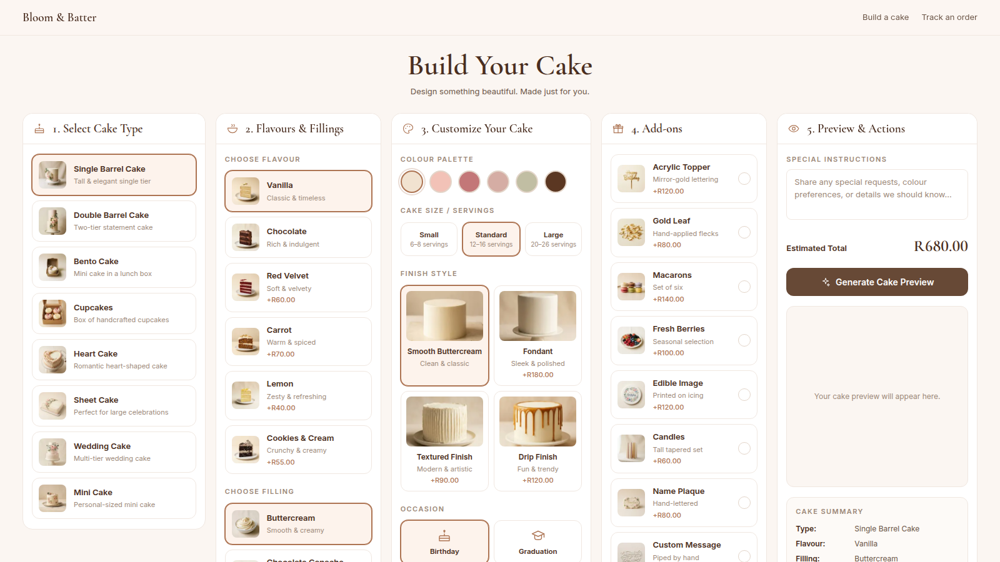

> A custom cake-ordering system for a small bakery. The customer designs a cake from approved options and sees the price change as they go. They get an AI-rendered impression of the cake, pay online, and track the order. The bakery gets a complete production brief instead of a WhatsApp thread.

**Stack:** Next.js 16 (App Router), React 19, TypeScript, Tailwind, Vercel Blob, OpenRouter (Gemini image model), PayFast. Deployed on Vercel.
**Status:** Live demo. Bloom & Batter is a fictional brand.
**Source:** private.
**Live demo:** [bakery.yourdesign.co.za](https://bakery.yourdesign.co.za/)

## The story

This started as a paid build for a real bakery. The work was well along when the owners closed the shop and emigrated, and it never went live in their store. By then the system worked end to end. I finished it under a fictional brand, Bloom & Batter, and kept it running as a demo anyone can click through.

Custom cake orders usually arrive as a WhatsApp thread: photos, half-decided options, a price worked out by hand, and details that get lost between the chat and the kitchen. The customer doesn't see what they are getting until collection.

## How an order works

1. The customer works through five columns: cake type, flavour and filling, how the cake looks (colour, size, finish, occasion), add-ons, and preview. There are 47 options in all, from 8 cake types to 8 add-ons.
2. The total updates with every choice. The opening price is the plain base cake: every default is the free option, and no extras are pre-selected.
3. **Generate Cake Preview** sends the design to an image model and shows an impression of the finished cake.
4. Some orders go to the bakery for a quote instead of straight to payment: wedding cakes, totals above a set amount, and any order with an inspiration photo, because a decorator has to look at it first.
5. Checkout hands over to PayFast. The order is marked paid when PayFast's server notification arrives, not when the browser comes back, because a redirect can be forged and a customer may close the tab.
6. The customer gets a tracking page. The bakery works the order from a password-protected board that shows the same brief the customer approved, with the earliest collection date worked out from the cake's lead time.

## Why this approach

One catalogue file drives everything. Every option, its price, its lead time, its tile image and the phrase used to describe it to the image model live in one place. The builder tile, the price, the order brief, the admin board and the render prompt are all derived from it, so adding a menu item is one edit.

The design lives in the URL. There is no cookie, session or local storage for a cake in progress. The configuration is encoded into a query parameter. That is how checkout receives the cake and how "back to the builder" restores it, and it means a design can be shared as a link.

Previews cost money, so they are cached. Each preview is filed under a SHA-256 hash of only the choices that change the picture. Ask for the same cake twice and the second render is free. Per-caller throttling is a backstop. The cache is the cost control.

The server trusts nothing the browser says about money. The price and the preview prompt are recalculated on the server from the design. An order recovers its preview image from the design hash rather than accepting an image URL from the client.

One deployment, one market. A build-time setting picks the country, which sets the currency, number formatting and the name of the tax. Prices are set per market, not converted. PayFast only settles in rand, so a build for another country swaps in a simulated checkout. That page carries no payment processor's branding, its card fields are fixed and disabled, and a large notice says no payment is taken. It refuses to render at all if live payment credentials are present.

The tile photography is generated too. The 34 option tiles were drawn by an image model from the same catalogue descriptions, at about R1.30 a tile.

## What is not production-ready

- Orders are not stored. They are held in memory and lost whenever the server instance recycles, which includes every deploy. The original owners declined a database. Storage sits behind an interface, so adding one is a single implementation.
- Payments run against the PayFast sandbox. No real money moves.
- The menu and prices belong to the demo brand, not to a real bakery.
- There is no automated test suite. Changes are checked by building and driving the app.
- Rate limiting is per server instance, so it is not a global guarantee. The preview cache is what keeps image costs down.

## Proof points

- The PayFast integration handles three details that each fail in a misleading way: the sandbox merchant needs its passphrase or the error reads as a broken signature; PayFast strips punctuation from item names before re-signing, so an ampersand breaks an otherwise correct signature; and field order is part of the signature.
- No customer personal data goes into blob storage, which is public. It holds only rendered previews and inspiration photos.
- The admin board sits behind an HMAC-signed cookie. With no password configured it stays closed rather than open.
- The order brief is one component, rendered identically in the builder, at checkout, on the tracking page and on the admin board.
- The URL codec runs in the browser and on the server, so it is written against web APIs (`btoa`, `TextEncoder`) rather than Node's `Buffer`.
- About 4,400 lines of TypeScript.

## What this proves

- [[skills/ai-agentic-systems|AI / Agentic Systems]]: an image model inside a product where every call costs money, fed a structured prompt built from the catalogue and cached by content hash.
- [[skills/design-brand|Design & Brand]]: the configurator layout, the generated tile photography, and an order brief that reads the same to the customer and the kitchen.
