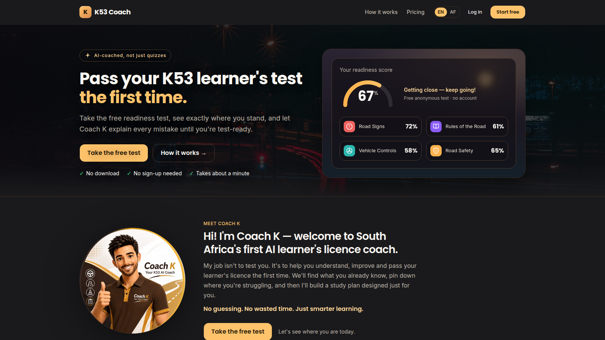

> A progressive web app for South African learner drivers sitting the K53 learner's licence test. A free readiness test, timed mock papers, an AI coach held to a verified corpus, and English and Afrikaans end to end. Built for a client and live at k53coach.co.za.

**Stack:** Next.js 16 (App Router), React 19, TypeScript, Tailwind v4, shadcn/ui on Base UI, next-intl, Supabase (Postgres, Auth, row-level security), OpenRouter, PayFast. Deployed on Vercel.
**Status:** Live. Client project, taken from spec to production.
**Source:** private.
**Live:** [k53coach.co.za](https://k53coach.co.za/)

## What it is

The learner's licence test has three sections: road signs, rules of the road, and vehicle controls. Most study apps for it are a question bank with a score at the end. K53 Coach is built around a different job: tell the learner, and the parent paying, how close they are to passing and what to work on next.

Anyone can take a five-question readiness test without an account and get a read on where they stand. That result stays in the browser. Under-18 learners are a large part of the market, so nothing an anonymous visitor does is sent to a server. A free account adds one 20-question mock paper with an assessment of the result. A once-off 90-day pass opens the rest:

- Mock exams for all three learner's licence codes: motorcycle, light vehicle and heavy vehicle. Each is a timed 64-question paper (30 rules, 28 signs, 6 controls), and each section is scored on its own, as in the real test. The controls questions are specific to the vehicle class. Rules and signs are shared.
- A written library of 380 road signs, 30 road-rule lessons and 30 vehicle-control lessons. Every question resolves to the lesson that teaches it.
- Ask Coach, a chat tutor that answers questions about the test from about 700 verified passages and from nothing else.
- A readiness score on the dashboard that blends practice and mock results by section.

Everything a learner reads is in English and Afrikaans. Sign-in is a six-digit code sent by email or WhatsApp, and one account can hold both. Payments go through PayFast.

## Why this approach

Accuracy is the product. A wrong answer in a driving-test app teaches the wrong law to someone who is about to drive. The rule through the whole build was that AI drafts and a person signs off, and a model checking its own output does not count as a check. All 334 approved questions and all 380 served signs carry a recorded human sign-off in both languages. Most questions also carry a citation to the regulation or chart entry they rest on, kept in a separate field so the explanation can stay plain.

The road signs come from the public domain, not from a model. The official Southern African sign set is on Wikimedia Commons, and official signs are public domain under South African copyright law. Commons licences are per file, so every SVG was licence-checked on its own. Each one was then verified against the Department of Transport's official chart twice: a semantic check (code, name and meaning match the chart) and a vision check (the artwork matches the chart's drawing). Anything that failed either check went to a human queue, and learners only see signs that passed both. Every sign stores its evidence. That mattered: a later artwork audit still found 13 blank plates, 3 signs that are not South African, and 7 de-restriction signs drawn wrong.

Explanations are written, not generated. When a learner gets a question wrong, the explanation they see is fixed, reviewed prose. There is no model call per question. The AI runs where a written answer can't: the assessment after a mock paper, the read on the free readiness test, and Ask Coach. The explanations follow a house rule: say what the driver does, lead with the confusion the question turns on, and keep the regulation number in the citation field. The median sign explanation is 187 characters.

Ask Coach is held to its sources by a validator, not by retrieval. Retrieval picks candidate passages and keeps the prompt small. It is lexical, and adding one K53 term to an unrelated question gets it through. What actually holds the line is the check on the reply. An answer must cite a passage, its wording must overlap what it cites, every number with a unit must appear in a cited passage, and a list of forbidden claims catches certification promises and foreign road law. There is no web search. A question the corpus does not cover gets an honest "not covered" and lands in an admin review queue, so the gap becomes a content task instead of a wrong answer. The thresholds are pinned by 121 query cases and 22 validator cases in the test suite, and loosening one to fix a false rejection fails another.

The free tier is built so the bank can't be scraped. Free practice is a fixed, hand-picked set of 30 questions that never rotates, so refreshing reveals nothing new. Answer options are shuffled on every sitting, so a retake tests the answer and not where it sits. A mock paper draws from questions the learner has not seen in their last two papers. At live pool sizes that took paper-to-paper repeats from 24% to 0%.

A commercial study guide was used as a checklist, never as a source. The client supplied a published K53 guide that nobody on the project holds the rights to. Only its topic labels were used, to find gaps in coverage. Every explanation was drafted from the National Road Traffic Act, its regulations and the official chart, and the guide was never passed to a model.

## What will break

- One person, two accounts. A learner who registered with a cellphone number and later signs in with an email address gets a second, empty account. The sign-in flow steers away from this, but it is mitigated, not prevented.
- The coach's guard is only as good as its tests. Retrieval is defeatable by design and the reply validator is what holds. A prompt change needs the live adversarial run, not only the unit tests.
- The paper format per code is an assumption. The regulations make the controls questions class-specific but do not publish a paper layout per code. All three codes use the same 30/28/6 split because the client chose it, not because a source says so. The extended light-vehicle code (EB) has no paper yet, and the exam engine refuses to build one rather than borrowing the light-vehicle layout.
- Price and licence code are kept apart on purpose. One price buys everything, so the licence code never travels with a payment. Per-code pricing would reverse that. The code would then have to ride on the checkout and the payment notification, or a learner could switch codes between paying and being granted access.
- Translations fall back when the English changes. A signed-off Afrikaans text is tied to a hash of its English. Edit the English and that item serves English until someone signs off the Afrikaans again. That is the safe failure, but an English correction always means a second review.

## Proof points

- Access is granted by PayFast's server-to-server payment notification, not the browser redirect, and the handler rejects any amount that does not match the price.
- Ask Coach usage is reserved, not counted. A per-user lock stops several open tabs from each reading "24 of 25 used" and each going ahead. Row-level security stops a learner from writing a coach reply into their own conversation.
- AI cost per use is measured from live usage: about R0.07 per Ask Coach message and under R0.10 for a typical mock assessment.
- Bulk translation drafts run through a batch API at roughly half the live price. The 28 heavy-vehicle questions were drafted for $0.19 and then went to the client for review.
- The Afrikaans went through a three-model review panel, then the client read it in full: a 4,659-row sheet with English and Afrikaans side by side.
- Learners can flag any question or sign as wrong. The report snapshots what they saw, with the keyed answer read on the server, and filing it never calls an external service. Triage pushes it to the issue tracker by hand, so a tracker outage cannot lose a report.
- The app collects and stores no biometric data.
- 41 database migrations, row-level security on every table, and an end-to-end test that signs in as a real learner, so an unauthenticated 401 cannot pass as a result.

## What this proves

- [[skills/ai-agentic-systems|AI / Agentic Systems]]: model output is treated as a claim to check. A validator decides what the coach may say, and AI drafts content but never signs it off.
- [[skills/design-brand|Design & Brand]]: one shared set of quiz components behind the landing demo, the readiness test, practice and the mock paper, mobile-first and in two languages.

## Decisions worth a deeper read

- [LLMs behind typed contracts, not vibes](https://yourdesign.co.za/notes/llms-behind-typed-contracts/)
- [Ship the feedback loop](https://yourdesign.co.za/notes/ship-the-feedback-loop/)
